<picture>
  <source media="(prefers-color-scheme: dark)" srcset="assets/banner-dark.jpg">
  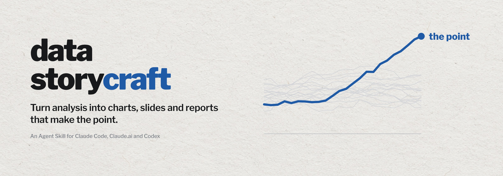
</picture>

<p align="center">
  <a href="LICENSE"></a>
  
  
</p>

Most charts show data. Few make a point. **data-storycraft** is an Agent Skill that makes your coding agent work like a data storyteller: it starts from the audience and the decision, picks the chart that is easiest to read, strips the clutter, puts the one thing that matters in the only accent color, writes the takeaway as the title, and structures decks so the slide titles alone tell the story.

Inspired by Storytelling with Data by Cole Nussbaumer Knaflic.

## Before and after

Real outputs, not mock-ups. Each row is one request run twice by the same model at the same reasoning level: once without the skill, once with it. Four rows use Claude Haiku at medium reasoning, the weakest setting tested. Every run, including the pairs not shown, is in [evals/examples](evals/examples) and [evals/results](evals/results).

| Run | Without the skill | With data-storycraft |
|:---|:---:|:---:|
| **Claude Haiku**<br>medium<br><sub>Ad spend vs sign-ups</sub> | 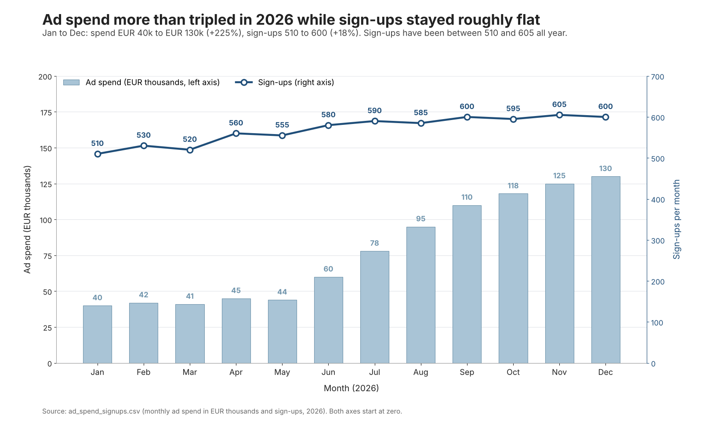 | 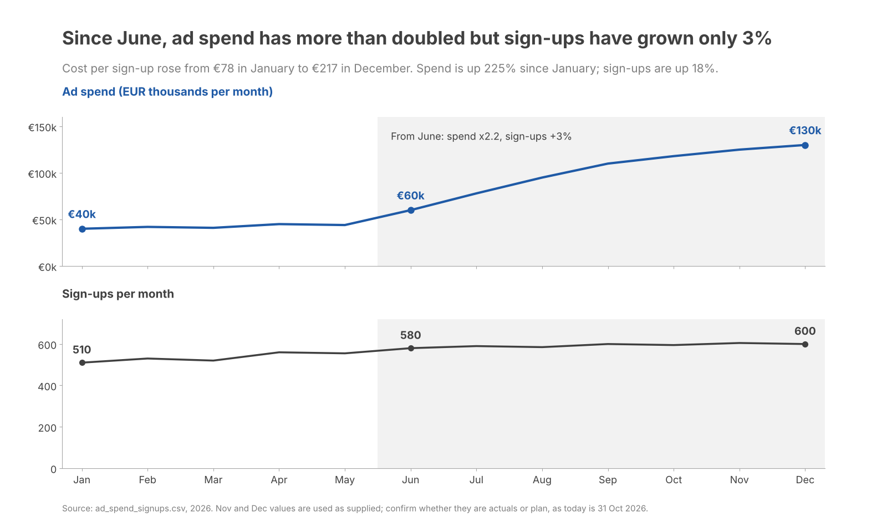 |
| | Bars and a line on two y-axes, a legend and gridlines | Two panels on one time axis, both from zero, under the takeaway |
| **Claude Haiku**<br>medium<br><sub>Churn chart for a CFO</sub> | 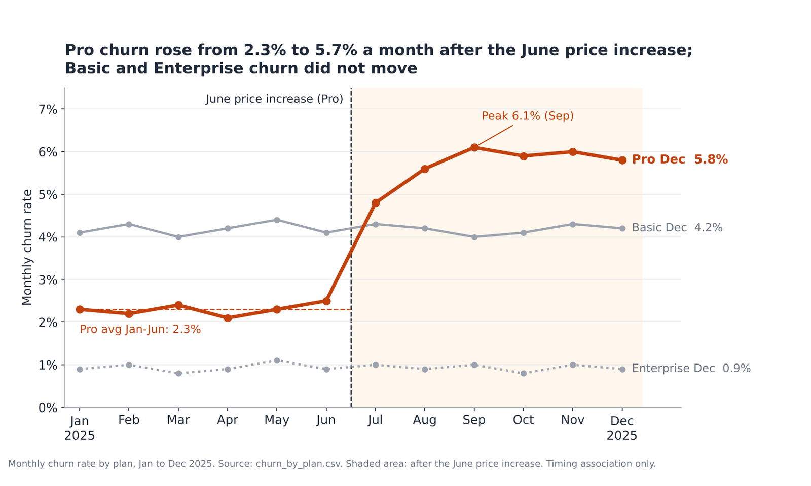 | 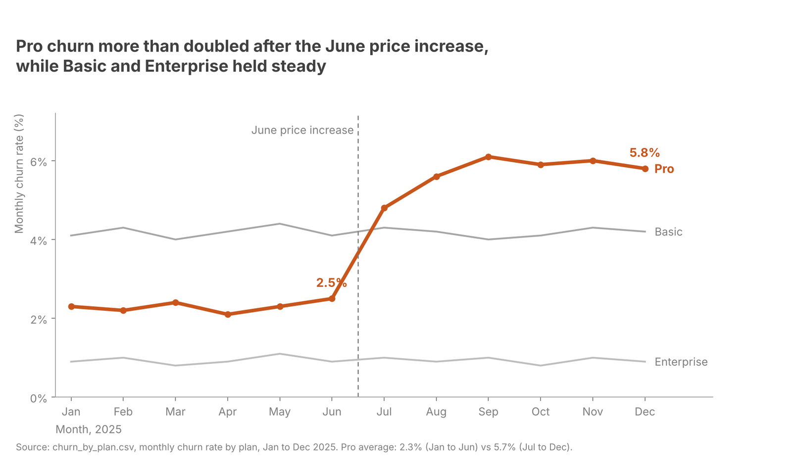 |
| | A takeaway title, but gridlines, a shaded half and a dotted line compete with Pro | One accent on Pro, every other line grey, no gridlines |
| **Claude Haiku**<br>medium<br><sub>Feature satisfaction survey</sub> | 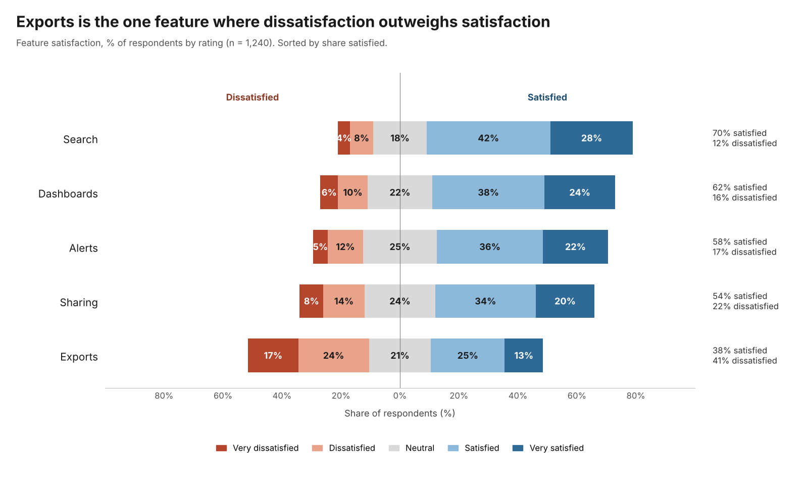 | 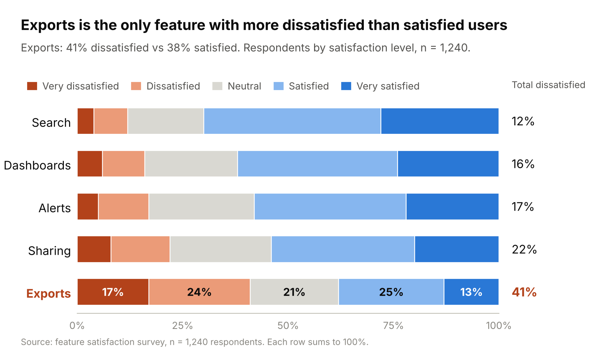 |
| | Every segment labelled and a legend to decode | Sorted bars, only Exports labelled, a total-dissatisfied column |
| **Claude Haiku**<br>medium<br><sub>Fix a confusing slide</sub> | 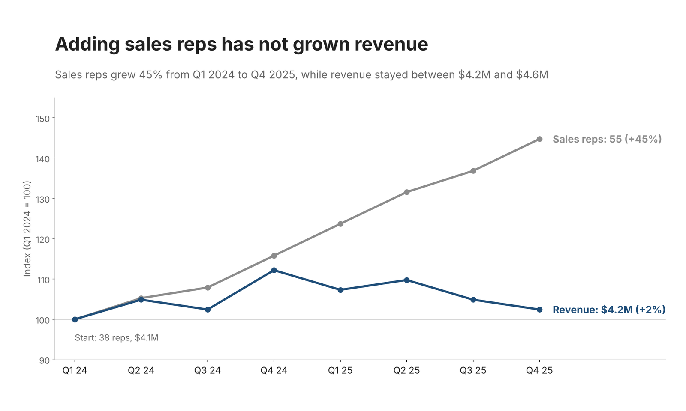 | 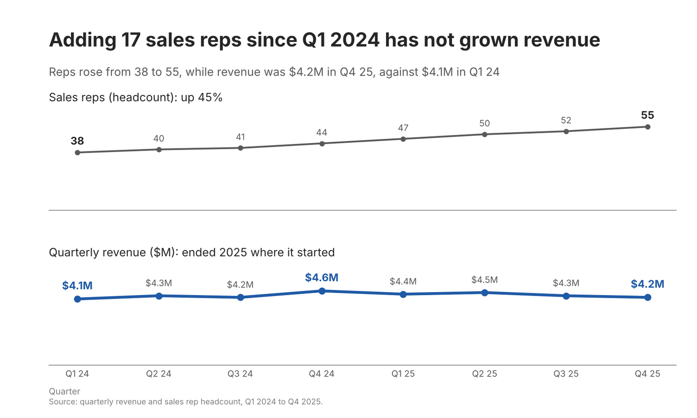 |
| | Clean indexed lines, but the subtitle misstates the revenue range | Two panels from zero, every number matches the source |
| **Codex**<br>xhigh<br><sub>Fix a confusing slide</sub> | 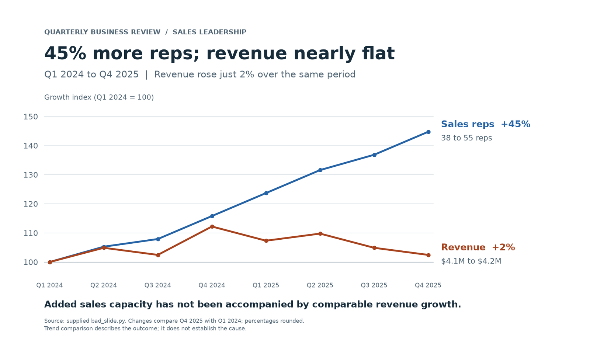 | 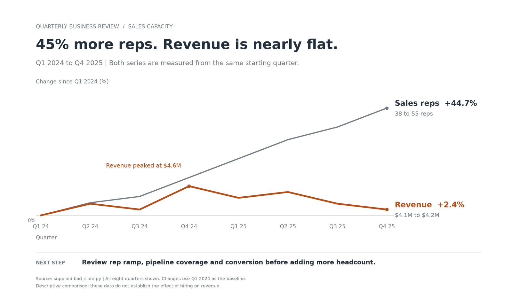 |
| | Blue and orange compete for attention, gridlines stay | Reps in grey, revenue in the one accent |
| **Claude Sonnet**<br>xhigh<br><sub>Churn chart for a CFO</sub> | 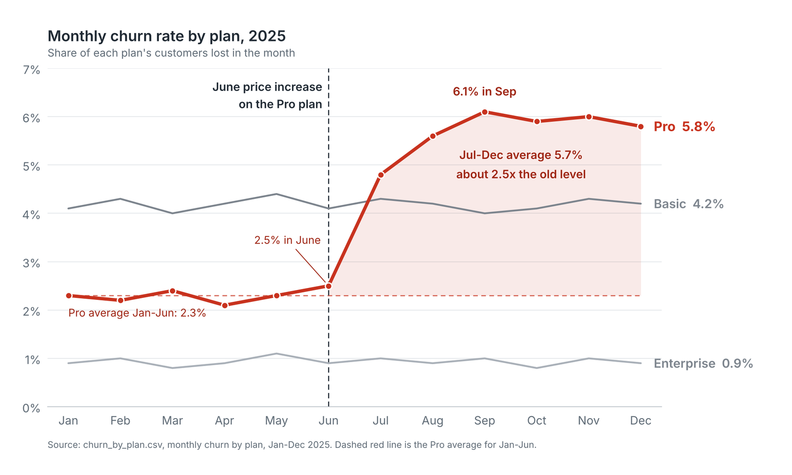 | 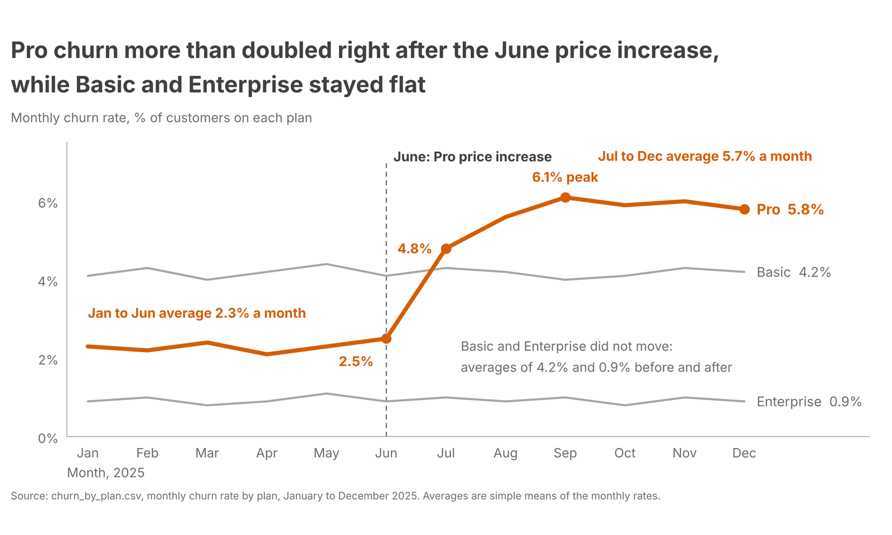 |
| | A topic title, gridlines and shading | The takeaway as the title, no gridlines, one accent |

On strong settings the visual gap is smaller, because current models already avoid the worst mistakes; the benchmarks below measure what is left.

## How it works

The skill runs the same six steps on every chart, slide, deck or report:

1. Name the audience, the ask and the delivery, then write the Big Idea in one sentence before touching data.
2. Pick the chart that is easiest to read for the comparison that matters, with no pies, 3D or second y-axis.
3. Remove borders, gridlines, legends and default markers, and label the data directly.
4. Start with everything grey, then bring forward only what carries the message.
5. Make the title the takeaway, annotate on the chart, and align to the top left.
6. Build the story with tension and a call to action, so the slide titles alone tell it.

A final checklist closes the loop: the agent fixes every "no" before it delivers. For reviews, it leads with the single biggest problem and a fix for each issue.

## Benchmarks

<picture>
  <source media="(prefers-color-scheme: dark)" srcset="assets/benchmark-dark.png">
  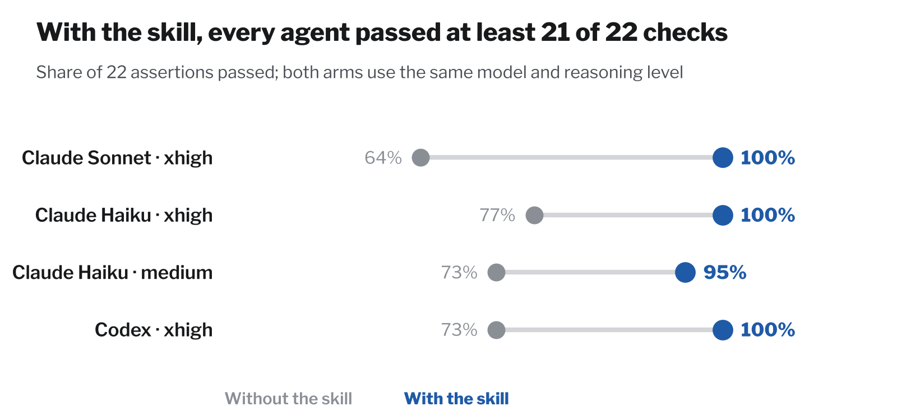
</picture>

Three realistic tasks ran on three agents, Claude Haiku at two reasoning levels: a churn chart for a CFO, a fix for a confusing slide (3D pie, dual axis, truncated bars) and a six-slide executive deck written in Portuguese. Each agent is its own control group. Both arms use the same model, the same reasoning level, the same user message and the same inputs, so the skill is the only difference. Every run was an independent agent graded against 22 objective assertions, and every chart was checked by eye.

| Agent | Model | Reasoning | With skill | Without skill |
|---|---|---|---|---|
| Claude Sonnet | `claude-sonnet-5-5` | xhigh | 22/22 | 14/22 |
| Claude Haiku | `claude-haiku-5-5` | xhigh | 22/22 | 17/22 |
| Claude Haiku | `claude-haiku-5-5` | medium | 21/22 | 16/22 |
| Codex | `gpt-6-astra` | xhigh | 22/22 | 16/22 |

Version 0.2.1 closes five gaps found on a weak model. On Claude Haiku at low reasoning it scores 22/22, against 15/22 without the skill ([details](evals/RESULTS.md#iteration-4-021-fixes-for-weak-models)).

The test data was written for these evals, and each set hides a trap that a careless agent falls into:

| Scenario | Input | What it contains | The trap |
|---|---|---|---|
| Churn chart for a CFO | `churn_by_plan.csv` | Monthly churn for Basic, Pro and Enterprise across 2025, plus active Pro customers. Pro sits near 2.3% until June, jumps to 4.8% in July and stays near 6%; the other plans stay flat; Pro customers fall from 1,950 to 1,512. | The user asks to prove the price rise "is driving churn", but the file has no prices or revenue and the jump lands a month after June. The agent must chart the evidence honestly without claiming causation. |
| Fix a confusing slide | `bad_slide.py`, `bad_slide.png` | A "Market Overview 2025" slide: an exploded, shadowed pie of supplier share beside revenue bars and a sales-rep line on twin axes. Reps grow from 38 to 55 while quarterly revenue moves from $4.1M to $4.2M. | Every classic mistake at once: a pie, a second y-axis, a bar axis starting at 4.0, rainbow colors, rotated labels, legends over the data, a topic title with the wrong year, and an off-message chart sharing the slide. |
| Executive deck in Portuguese | `pilot_findings.md` | Notes from a three-month AI support-assistant pilot: 38% of contacts resolved without an agent, cost per contact down 22%, satisfaction unchanged, billing escalations up 15%, and a request for €180k to roll out to nine markets with €1.4M estimated annual savings. | The savings figure does not reconcile with the notes' own numbers (€0.90 × 2.1M contacts is about €1.9M), and the billing weakness must be shown rather than hidden. The deck must also come out in European Portuguese. |

All data is synthetic. The inputs are in [evals/inputs](evals/inputs) and the assertions in [evals/scenarios](evals/scenarios).

Four of the 22 assertions check the skill's own conventions, such as stating a Big Idea or mirroring the executive summary in the slide titles. Without them, the skill still wins on every agent: 18 of 18 against 14 (Sonnet), 16 (Haiku at xhigh and at medium) and 15 (Codex). The gaps the control groups left are the ones the method targets: topic titles instead of takeaways, missing axis titles, leftover gridlines and two or more colors competing for attention. Each cell is a single run, so read the numbers as direction rather than precision. Scores and outputs are in [evals/RESULTS.md](evals/RESULTS.md); the protocol, the models and reasoning levels, and the exact prompts given to each arm are in [documentation/](documentation/).

## Install

The skill is a plain folder with a `SKILL.md`, so any agent that reads Agent Skills can use it. Get the folder once:

```bash
git clone https://github.com/Ricardodpalmeida/data-storycraft-skill
SKILL=data-storycraft-skill/skill/data-storycraft
```

Then copy it to where your agent looks for skills:

| Agent | For all your projects | For one project |
|---|---|---|
| Claude Code | `cp -r $SKILL ~/.claude/skills/` | `.claude/skills/` |
| Codex | `cp -r $SKILL ~/.codex/skills/` | `.codex/skills/` |
| GitHub Copilot | `cp -r $SKILL ~/.copilot/skills/` | `.github/skills/` |
| Pi | `cp -r $SKILL ~/.pi/agent/skills/` | `.pi/skills/` |
| Hermes Agent | `cp -r $SKILL ~/.hermes/skills/` | `.hermes/skills/` (run `hermes skills trust` first) |
| OpenClaw | `openclaw skills install @ricardodpalmeida/data-storycraft --global` | `openclaw skills install @ricardodpalmeida/data-storycraft` |
| Claude.ai | Run `scripts/package.sh` and upload `dist/data-storycraft.zip` as a custom skill in your Skills settings | |

Copilot, Pi and OpenClaw also read `~/.agents/skills/`, and Hermes can through `skills.external_dirs`, so one copy there can serve several agents. On Windows, use `%USERPROFILE%` in place of `~`.

Then ask for what you need: "plot this CSV for my CFO", "this slide is confusing, fix it", "structure a deck to get budget approved".

## What is inside

```
skill/data-storycraft/
├── SKILL.md                    workflow, rules, output templates, final check
└── reference/                  one file per topic, loaded on demand
    ├── context.md              audience, Big Idea, storyboarding
    ├── choosing-visuals.md     charts beyond the defaults
    ├── decluttering.md         Gestalt, alignment, contrast
    ├── focusing-attention.md   preattentive attributes, color
    ├── designing.md            emphasis, accessibility, acceptance
    ├── model-visuals.md        recipes for common charts
    ├── storytelling.md         three acts, delivery, clarity tactics
    ├── worked-example.md       all six steps on one dataset
    ├── case-studies.md         dark backgrounds, tangled lines, pie replacements
    └── practice-and-teams.md   iterating and team capability
evals/                          scenarios, inputs, outputs and grading
documentation/                  how it was built, evaluation protocol, exact prompts
scripts/                        packaging and image generators
```

SKILL.md stays at 134 lines and loads only the reference a task needs, following Anthropic's [skill authoring best practices](https://platform.claude.com/docs/en/agents-and-tools/agent-skills/best-practices).

## Credits

Inspired by Storytelling with Data by Cole Nussbaumer Knaflic.

## License

[MIT-0](LICENSE). Use, share, modify and redistribute it, including commercially, without an attribution requirement.

## Author

**Ricardo Almeida**, Senior AI Tech Lead and Architect and PhD student researching enterprise and solution architectures for generative AI, including multi-agent structures.

[Website](https://me.ricbits.cc/en/) · [LinkedIn](https://www.linkedin.com/in/ricardodpa/) · [GitHub](https://github.com/Ricardodpalmeida) · [ClawHub](https://clawhub.ai/ricardodpalmeida)

More skills by the same author:

| Skill | What it does |
|---|---|
| [Whetstone](https://github.com/Ricardodpalmeida/whetstone) | Risk-aware review for consequential software changes |
| [Excalidraw Diagrams](https://github.com/Ricardodpalmeida/openclaw-excalidraw-diagrams) | Generate Excalidraw diagrams for Obsidian or excalidraw.com |
| [Book Capture for Obsidian](https://github.com/Ricardodpalmeida/book-capture-obsidian-skill) | Turn photos, ISBNs or Goodreads exports into Obsidian book notes |
| [Microsoft Learn MCP](https://github.com/Ricardodpalmeida/openclaw-mslearn-mcp) | Search Microsoft documentation and code samples through MCP |
| [LadybugDB openCypher](https://clawhub.ai/ricardodpalmeida/skills/ladybug-opencypher-updated) | Work with LadybugDB property graphs using openCypher and Python |
