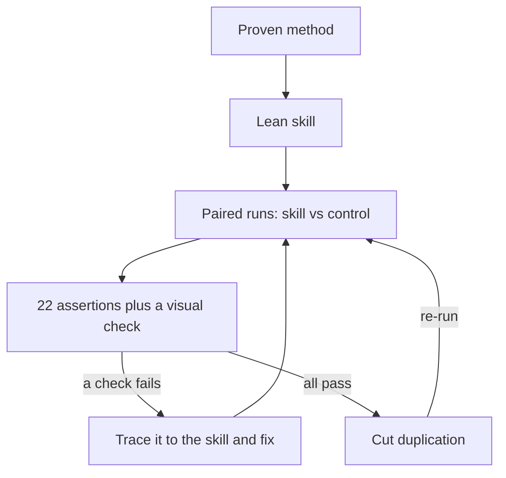

# How the skill was built

data-storycraft was built like a small product: a defined user, a specification written as tests, and changes made only when a measurement called for them.

## 1. Start from a proven method

The source is the method in *Storytelling with Data* (Knaflic, 2015), read end to end. The skill is written in its own words and credits the book as inspiration.

A method makes a good skill because models already know the individual rules; ask one about pie charts and it will tell you. What they lack is the order and the habit: audience before chart, chart before polish, a test before delivery. A method supplies exactly what a skill needs, a workflow, a set of defaults and a checklist.

The scope is explanatory communication: one audience, one message, one action. Exploratory analysis is excluded on purpose, because emphasis hides the patterns an analyst is still looking for.

## 2. Design for how agents read

| Practice | Where it shows up in the skill |
|---|---|
| Lean entry point | `SKILL.md` is 134 lines: workflow, defaults, rules, output templates and a final check |
| Progressive disclosure | Ten references organised by topic, one level below `SKILL.md`, 12 to 42 lines each, opened only when a task needs them |
| A description that triggers | Third person, says what the skill does and when to use it, with the phrases people actually type ("plot this", "make this slide clearer") |
| Verifiable steps | A four-line context block (Audience, Ask, Mechanism, Big Idea) at the top of every output; reviews open with the single biggest problem |
| A feedback loop | A nine-question final check: fix every "no", check again, deliver only when all pass |
| One term per concept | Big Idea, accent and action title mean the same thing in every file |
| Calibrated freedom | Six rules that hold almost always (bars start at zero, no pies, no 3D, no secondary y-axis, consistent intervals, no distorted scales); everything else is a default that leaves room for judgment |
| Safe alongside other skills | If another chart skill is loaded, its rendering mechanics stay and this skill's emphasis rules win where they conflict |
| Defaults that support the method | A matplotlib starting point with a grey base, one accent, top and right spines off and a left-aligned title |

## 3. Write the specification as tests

The evaluation was treated as the specification. Three scenarios mirror real requests, each built on synthetic data with a planted trap: a causal claim the data cannot prove, a slide with every classic charting mistake, and a savings estimate that does not reconcile with its own numbers. The [README](../README.md#benchmarks) describes each dataset and its trap.

Success is defined by 22 binary assertions. Four of them test conventions the skill itself introduces, so every result is reported with and without those four. Each model is its own control group, and the only variable between arms is the skill. [evaluation.md](evaluation.md) has the full protocol and [prompts.md](prompts.md) the exact prompts.

## 4. Measure, fix, measure again

Every failure was traced to something in the skill, never written off as the model's fault.

| Round | What ran | Result (of 22) | What changed afterwards |
|---|---|---|---|
| 1 | First version: Sonnet and Haiku with the skill, Sonnet control | 20, 20 vs 13 | Executive-summary mirroring moved from a reference into `SKILL.md`; an invitation to load a second chart skill (about 30% more tokens) became a conflict rule; the declutter step was tightened on gridlines |
| 2 | Targeted re-runs of the two cells that missed | Haiku deck 7/7 (was 6/7); Sonnet churn 8/8 (was 7/8) at 124k tokens instead of 145k | The review for verbosity and duplication (section 5) |
| 3 | Revised skill: Sonnet and Haiku, each with its own control | Sonnet 22 vs 14; Haiku 22 vs 17 | None needed |
| Haiku medium | Same scenarios on Claude Haiku at medium reasoning | 21 vs 16 | None needed |
| Luna low (external) | Same scenarios on gpt-6-luna at low reasoning, skill 0.2.0 | 17 vs 13 | Five rules tightened in 0.2.1 (about 80 words) |
| 4 | 0.2.1 vs 0.2.0 vs no skill on Claude Haiku at low reasoning | 22, 21 vs 15 | None needed |
| Luna low, second round (external) | 0.2.1 vs 0.2.0 | 19 vs 18 | Title, labels, summary and reconciliation rules sharpened in 0.2.2 |
| 5 | 0.2.2 on Claude Haiku at low reasoning, deck run three times | Churn 8/8, slide 7/7, deck mirrored 3 of 3 | Big Idea template asks for the amount |
| Codex | Same scenarios and skill version on Codex | 22 vs 16 | None needed |

## 5. Cut without losing behaviour

Once the behaviour was right, a review for verbosity and duplication took the skill from 6,504 to 4,781 words (26% fewer) and `SKILL.md` from 164 to 134 lines. The rule was one home per idea: `SKILL.md` holds the workflow and defaults, the references hold nuance and examples, and nothing is stated twice.

A cut that loses behaviour is not a saving, so round 3, the Haiku medium round and the Codex round all ran on the shorter version. Every agent scored at least 21 of 22 with it.

## 6. Ship it auditable

- Every input, every output of every run, the grades and the exact prompts are in the repository.
- The README shows six before-and-after pairs of real outputs, each from one model at one reasoning level, and a benchmark chart drawn with the method itself.
- The install guide covers Claude Code, Claude.ai, Codex, GitHub Copilot, Pi, Hermes Agent and OpenClaw.
- The license is MIT-0: use it freely, without an attribution requirement.
