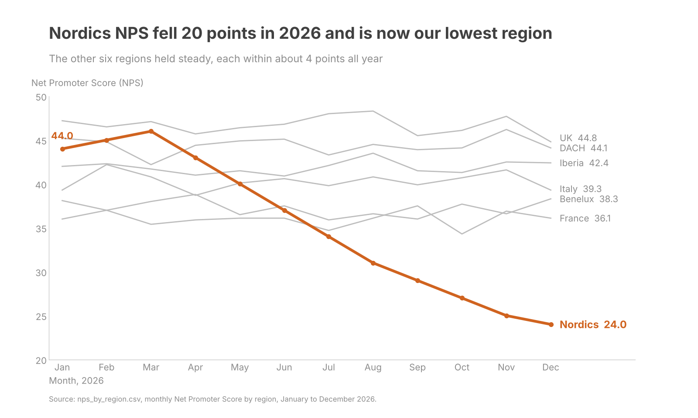

# NPS by region, 2026: QBR chart

```
Audience:  Quarterly business review leadership (regional and commercial heads)
Ask:       Approve a root-cause review of Nordics NPS and set a recovery target for Q1 2027
Mechanism: Both (presented on a slide, also sent as a document)
Big Idea:  Nordics NPS fell 20 points in 2026 (44.0 in January to 24.0 in December) and is now our lowest region; the other six regions held steady, so the problem is local and needs an owner now.
```



**What the chart shows.** Nordics peaked at 46.0 in March, then declined every month to 24.0 in December. It has been the lowest region every month since July. Its Q1 average was 45.0 and its Q4 average was 25.3. The other six regions stayed within a band of about 4 points each across the year.

**Where the eye lands first.** The orange Nordics line falling from the top left to the bottom right, which is the only colored element on the chart.

**Data that cuts against the story.** The UK fell 2.4 points from January to December, the largest move among the other six, and DACH fell 1.1. Neither is a warning sign on the scale of Nordics, but the QBR audience may ask about them, so the answer should be ready.

**Assumptions I made**

- The audience is the QBR leadership group, and the ask is a Nordics review plus a recovery target. The brief did not name an ask, so please change it if the decision is different.
- Each value is the monthly NPS for that region as given. The file has no response counts, so I could not check the statistical significance of month-to-month moves.
- There is no target or benchmark in the data, so the chart shows no goal line. Adding the target would make the gap to goal explicit.
- Y axis runs from 20 to 50. It is a line chart, so a zero baseline is not required.

Files: `chart.png` (1600 x 960), `script.py` (reproduces the chart from the input CSV).
