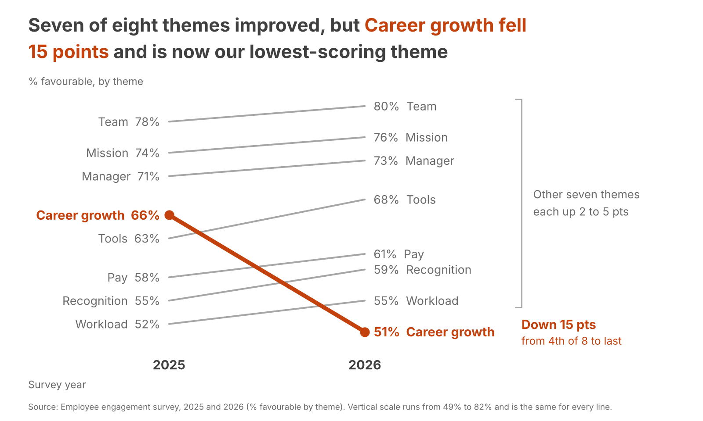

```
Audience:  Leadership team, the group that decides where people investment goes next
Ask:       Agree that Career growth is the top people priority and commission a review of why it fell
Mechanism: Both. A pre-read for the leadership team, then the same chart on one slide in the meeting
Big Idea:  Seven of eight themes improved by 2 to 5 points, but Career growth fell 15 points to 51%
           and is now our lowest-scoring theme, so we recommend making it the top people priority
           and commissioning a root-cause review.
```



The eye lands first on the orange phrase in the title and then on the thick orange line dropping to the bottom right, because it is the only saturated colour on an otherwise grey chart.

**What the chart shows**

I used a slopegraph, since the question is how each theme changed between two points. Seven themes are thin grey lines that rise gently, with a bracket summarising them as up 2 to 5 points. Career growth is the one thick orange line, falling from 66% (4th of 8) to 51% (last). Orange marks the negative finding, and the improvements stay grey so there is a single accent. Every value is labelled directly, so there is no legend and no y-axis. The title states the takeaway, and the footnote gives the source and the vertical scale.

**Assumptions I made**

- You gave no ask, so I inferred one that follows from the data: prioritise Career growth and find out why it dropped. If leadership is being asked for something else (budget, a named owner), only the ask line and the Big Idea change, and the chart stays as it is.
- The two years use the same questions and a comparable population, so the 2025 and 2026 percentages can be compared directly.
- I had no response counts, so I did not test significance. A 15-point fall is large for almost any survey size. If the response base is small, the 2 to 3 point rises could be noise, and I would soften "improved" to "held or edged up" in the title for those themes.
- The data shows that Career growth fell, not why. The chart makes no claim about the cause, which is why the ask is a review.
- I kept your "favourable" spelling and the 1600 x 960 pixel size.

**Files**

chart.png is the chart, and make_chart.py regenerates it from engagement_survey.csv. The script builds the title and annotations from the data and checks that the message still holds (exactly one theme declined, and it is now the lowest), so a future year's file cannot silently produce a wrong headline.
