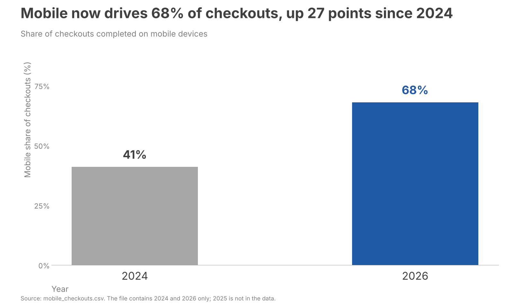

# Mobile share of checkouts: 2024 vs 2026

```
Audience:  E-commerce update readers (assumed: leadership and channel owners)
Ask:       Treat mobile checkout as the priority in the e-commerce plan
Mechanism: Sent document
Big Idea:  Mobile is now the majority checkout channel at 68%, up 27 points since 2024, so mobile checkout must come first in e-commerce investment.
```



The eye lands first on the blue 2026 bar and its 68% label, the only colored element, which carries the point that mobile is now the majority channel.

Assumptions and caveats:

- The input file has two data points, 2024 at 41% and 2026 at 68%. I used two bars instead of a line, because a line would imply a measured trend for 2025 that the data does not contain.
- The 27-point change is the difference between the two shares (68 minus 41), not a relative growth rate.
- The audience and ask were not specified, so I inferred them from the request ("for the e-commerce update"). Adjust the ask if the update has a different decision in mind.
- The footnote states the source and the missing 2025 value. If you have 2025 or other years, the chart can become a line with consistent yearly spacing.

Files:

- Chart: <workspace>/05-mobile-checkouts/with_skill_haiku/chart.png (1600 x 960 px)
- Script: <workspace>/05-mobile-checkouts/with_skill_haiku/make_chart.py
