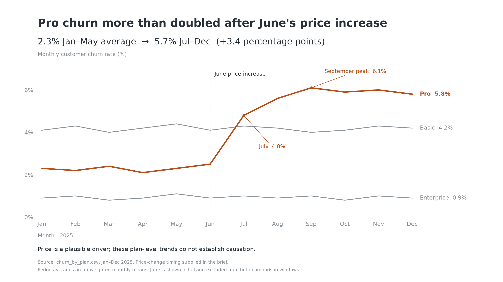

Audience: CFO, deciding whether to reverse the Pro price increase for existing customers.
Ask: Approve a controlled rollback test for customers affected by the increase, with wider rollout contingent on retention and financial results.
Mechanism: Live presentation next week, with this chart on one slide (assumed).
Big Idea: Pro churn more than doubled after June while other plans stayed stable, putting recurring revenue at risk; approve a targeted rollback test before committing to a permanent reversal.

The data supports concern about the price increase, but it cannot prove that the increase caused churn or that a broad rollback would pay for itself. The PNG preserves all three plans and every month.

:::writing{variant="standard" id="48271"}

- **Headline:** Test a rollback: Pro churn more than doubled after June.
- **Evidence:** Pro monthly churn averaged **5.7% in Jul–Dec**, up from **2.3% in Jan–May** (**+3.4 percentage points**). Basic stayed at **4.2%** and Enterprise at about **0.9%** across the same windows.
- **Decision:** Approve a controlled rollback test for existing Pro customers affected by the increase. Expand only if better retention offsets the lower price in contribution margin per eligible customer.
- **Small-print caveat:** Timing supports the price hypothesis; aggregate plan data does not establish causation.

:::

**What to say:** “Pro churn rose sharply in July and remained elevated. The stable Basic and Enterprise trends make the price increase a credible explanation, but those customers are not a randomized control group. We should test a rollback for affected existing customers and measure retention and financial impact before making it permanent.”

For the test, first confirm who actually received the increase and their renewal dates. Compare equivalent affected customers offered old pricing with a randomized holdout on current pricing, and agree the observation period and financial success threshold before launch. This CSV has no price exposure, churn counts, cancellation reasons or revenue data; it cannot isolate existing-customer effects or quantify rollback economics.

Assumptions: the rates represent monthly customer churn; June is the transition month; comparisons use unweighted monthly means, excluding June. The supplied file covers 2025 only, so this is historical evidence, not a current churn assessment. The June price-change timing comes from your brief.

The eye lands first on the orange Pro line and its post-June jump; the grey comparison lines show the stable context.

Files: `churn_cfo.png` (2560 × 1440), `chart.py` (reproducible script), and `notes.md` (skill reading record).

