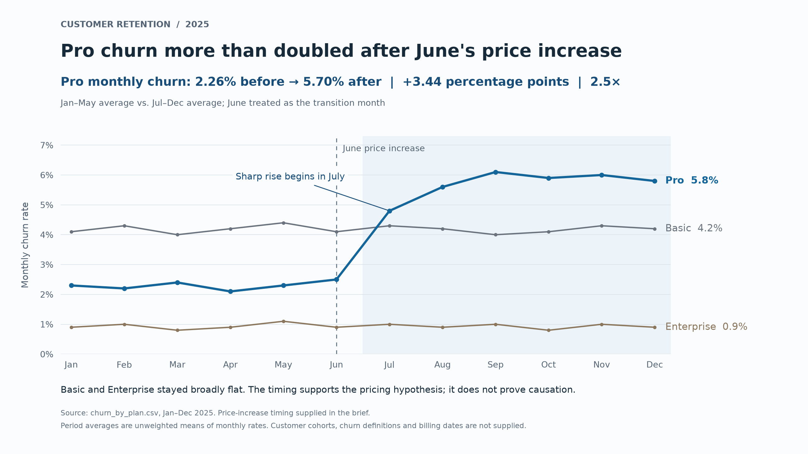

The chart shows a strong warning signal: Pro churn rose sharply after June's price increase while Basic and Enterprise stayed broadly flat. These aggregate data support investigating pricing as the cause, but they do not establish that the increase caused the churn or that a full rollback would improve profit.

**Put this on the slide**

**Headline:** Pro churn more than doubled after June's price increase

- Pro monthly churn averaged **5.70% in Jul–Dec**, up from **2.26% in Jan–May**: **+3.44 percentage points**, or **2.5×**.
- Basic and Enterprise churn stayed broadly flat, making the Pro-specific increase a priority to investigate.
- **Decision requested:** approve a time-limited price rollback test for existing Pro customers, with a full rollback contingent on improved retention economics.

**Small-print note:** Observational monthly data; causation is not established. Averages are unweighted; June is excluded from the before/after comparison as the transition month.

**What to say:** “The timing and the contrast with the other plans make pricing a credible explanation. Before committing to a permanent rollback, we should test restoring the old price for a randomly selected group of existing Pro customers against a comparable group on current pricing. Measure churn and net retained gross profit over the same renewal window, including the revenue given up through the lower price.”

**Before a full rollback:** verify when existing customers actually faced the new price, compare like-for-like customer cohorts, and check cancellation reasons, plan migrations and other Pro-specific changes. The file has no prices, margins, customer-level exposure or control for those factors, so it cannot quantify the financial benefit of rollback. Basic and Enterprise provide context, not proven equivalent control groups.

Assumptions: the June 2025 price increase is as described in your brief; the CSV's percentages are comparable monthly churn rates across the year; Jan–May represents the pre-change period and Jul–Dec the post-change period. The rise begins in July, not immediately in June. The Pro active-customer column is not assumed to be the at-risk denominator, so it is not used to weight churn rates or infer lost-customer counts.

Files: `churn_cfo.png` (2560 × 1440 PNG, 16:9) and `chart.py` (reproducible matplotlib script).
