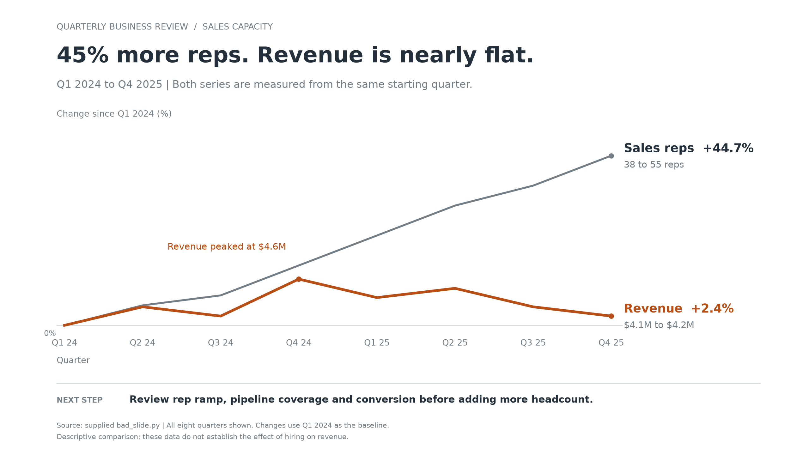

Audience: Sales leadership and the director at the quarterly business review.  
Ask: Review rep ramp, pipeline coverage and conversion before adding more headcount.  
Mechanism: Live presentation, with a PNG suitable for sharing afterward (assumed).  
Big Idea: Sales headcount grew 44.7% while quarterly revenue grew only 2.4% from Q1 2024 to Q4 2025, so review sales capacity effectiveness before committing to further expansion.

**Biggest problem:** The slide gives the most space and visual emphasis to market share, while the staffing-versus-revenue finding is buried in a misleading, hard-to-compare chart.

| Lesson | Issue | Why it hurts | Fix |
|---|---|---|---|
| Context | “Market Overview 2025” does not state the point and omits the 2024 portion of the timeline. | Leadership must infer both the message and the comparison period. | Lead with “45% more reps. Revenue is nearly flat.” and name the full period. |
| Visual | Revenue bars start at $4.0M; the rep line uses a separate scale. | Truncated bar lengths exaggerate differences, and two scales make the apparent relationship arbitrary. | Use two lines showing percentage change from the same Q1 2024 baseline. |
| Clutter | The unrelated pie, shadows, exploded slices, dense grid and angled labels dominate. | They consume attention without explaining the revenue result. | Remove the pie and decoration; keep all eight quarters with horizontal labels. |
| Focus | Rainbow bars and multiple bright pie segments compete. | Color implies distinctions that do not support the point. | Highlight revenue in orange, with headcount in grey. |
| Design | Legends and axes require repeated decoding. | Readers have to calculate the change themselves. | Directly label both series with their percentage changes and absolute endpoints. |
| Story | No next step follows the finding. | The discussion has no decision to work toward. | Add a proposed capacity-effectiveness review before further hiring. |

**Redesign:** A single 16:9 line chart with one shared percentage scale, a takeaway title, direct labels, the intermediate revenue peak and an explicit next step.

[Download the PNG](fixed_slide.png) · [Fixed Python script](fixed_slide.py)

The eye lands first on the large takeaway title, then on the orange revenue line and its +2.4% endpoint.

I retained the original data: reps rose from 38 to 55; quarterly revenue rose from $4.1M to $4.2M, after peaking at $4.6M in Q4 2024. “Nearly flat” is more accurate than “no growth.” Full-year revenue also changed little: $17.2M in 2024 versus $17.4M in 2025 (+1.2%).

Assumptions: The requested emphasis is the full supplied period; the added next step is a proposed discussion prompt, not an established company decision. Revenue units follow the original script's dollar labels. The chart was rendered with the specified Python, arithmetic checked and the final PNG visually inspected. The script saves the PNG beside itself; the missing plotting library was installed locally in this output folder.

I did not validate the supplied figures against business records. These aggregate data do not establish the causal effect of hiring or account for rep ramp time.
