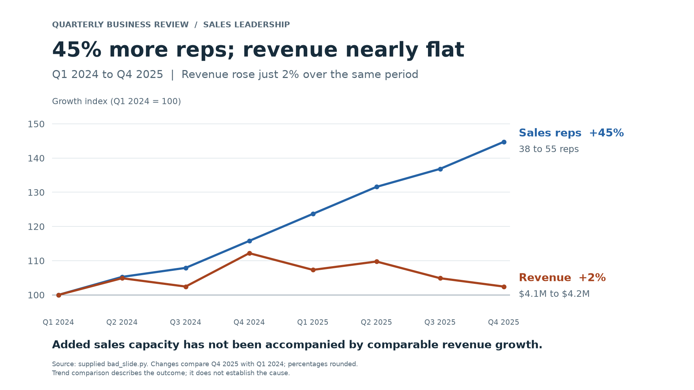

The slide hides the key message: **sales reps increased 44.7%, while quarterly revenue increased only 2.4%** from Q1 2024 to Q4 2025.

What makes the original confusing:

- The market-share pie takes half the slide but does not explain the hiring-versus-revenue story.
- The two vertical axes use unrelated scales, so their heights and slopes are difficult to compare reliably.
- The revenue bars start at $4.0M instead of zero, exaggerating small revenue changes.
- Rainbow bars, decorative pie effects and separate legends compete for attention. The title names a topic instead of stating the takeaway, and says 2025 despite showing two years.

I replaced it with a single indexed line chart: both series start at 100 in Q1 2024 and share one scale. Direct labels show the percentage changes and actual endpoint values. All eight quarters and their original values are preserved.

The new headline is **“45% more reps; revenue nearly flat.”** This is more accurate than claiming no revenue growth, and the chart does not claim that hiring caused the outcome.

Assumption: the intended comparison is the full supplied period, Q1 2024 to Q4 2025. Percentages on the slide are rounded to whole numbers.

[Download the fixed PNG](fixed_slide.png) · [Download the corrected script](fixed_slide.py)

